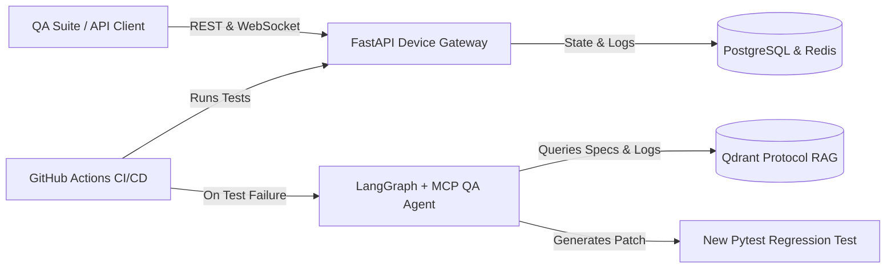

# Autonomous IoT QA & Device Control Platform

A cloud-native smart-home device gateway and autonomous quality-assurance platform built with **FastAPI, Docker, Qdrant RAG, and LangGraph agents**. Designed to replace local desktop testing tools with scalable REST/WebSocket control, automated CI/CD verification, and AI-driven root-cause log triage.

---

## System Architecture



---

## Core API Endpoints (`services/device_gateway`)

| Method | Endpoint | Description | Status Codes |
| :--- | :--- | :--- | :--- |
| `GET` | `/health` | Service health check | `200 OK` |
| `GET` | `/devices/discover` | List all active smart-home devices (`HTTP/SSDP`, `WebSocket`, `MiIO`) | `200 OK` |
| `POST` | `/devices/register` | Dynamically register a new simulated IoT device | `201 Created`, `409 Conflict` |
| `GET` | `/devices/{device_id}` | Retrieve live power and volume state for a device | `200 OK`, `404 Not Found` |
| `POST` | `/devices/{device_id}/command` | Execute `POWER_ON`, `POWER_OFF`, or `SET_VOLUME` commands | `200 OK`, `400`, `404`, `422` |
| `DELETE` | `/devices/{device_id}` | Deregister a device after test completion | `204 No Content`, `404 Not Found` |

---

## Quickstart (Local Development)

```bash
# 1. Activate virtual environment
source .venv/bin/activate

# 2. Install dependencies
pip install -r requirements.txt

# 3. Start the FastAPI server
uvicorn services.device_gateway.main:app --reload

# 4. Run the automated Pytest suite
pytest -v
```
Visit **`http://127.0.0`** to test all endpoints interactively via Swagger UI.

---

## 6-Month Engineering Roadmap
- [x] **Week 1:** FastAPI Device Gateway, Pydantic Schemas, CRUD Endpoints & Pytest Suite
- [x] **Week 2:** Real-Time WebSocket Telemetry Stream & Live Event Broadcasting
- [ ] **Week 3:** PostgreSQL Persistence & Redis State Caching
- [ ] **Week 4:** Multi-Container Docker Compose & AWS Free Tier Deployment
- [ ] **Month 2:** Parallel Pytest (`xdist`), Locust Load Testing & GitHub Actions CI/CD
- [ ] **Month 3:** Smart-Home Protocol & Crash-Log RAG Engine (`Qdrant` + `Ragas`)
- [ ] **Month 4:** Autonomous Self-Healing QA Agent (`LangGraph` + `MCP`)
